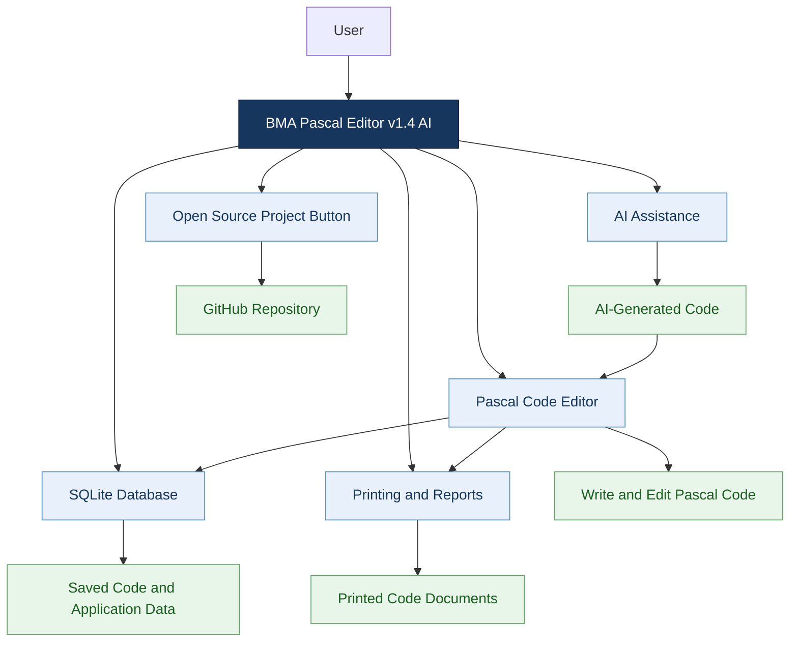

# BMA Pascal Editor v1.4 AI

**A Pascal programming environment designed to support learning, code development, and AI-assisted programming.**

BMA Pascal Editor is a Delphi-based application focused on Pascal programming and education. It combines a programming workspace with AI-assisted code generation, code management, and printing tools to help users work with Pascal code more efficiently.

Version **1.4 AI** introduces several important improvements to the application’s database, open-source accessibility, AI-generated code presentation, and printing experience.

## What's New in Version 1.4 AI?

### 1. Migration from Microsoft Access to SQLite

The application's database has been migrated from Microsoft Access to SQLite.

This change modernizes the application's data-storage layer and removes its dependency on the previous Access database for the migrated functionality.

Key improvements:
- A SQLite-based database.
- Updated data storage for application features that use the database.
- A more convenient foundation for maintaining and developing the application.

### 2. Open-Source Project Access

A dedicated **Open Source Project** button has been added to the application.

This provides users with a direct way to access the project's public source code on GitHub, making it easier to explore the implementation, study the code, and follow future development.

**GitHub repository:**  
[https://github.com/BoutelisMohamedElAmine/BMA-Pascal-Editor](https://github.com/BoutelisMohamedElAmine/BMA-Pascal-Editor)

### 3. Improved AI-Generated Code Presentation

The presentation of code generated through AI assistance has been improved.

The goal is to make generated Pascal code easier to read and work with inside the editor, creating a more convenient transition from AI-generated output to programming and further editing.

### 4. Improved Printing

The printing functionality has been improved to provide a better presentation of code in printed documents.

These improvements focus on making printed code more readable and improving the overall report layout.

## Project Architecture

The following diagram illustrates the main conceptual components of BMA Pascal Editor and how they interact.

*Note: This is a conceptual architecture diagram showing the application's main features, not a complete representation of its internal classes or source-code dependencies.*

## Technologies

- **Delphi** — application development.
- **Object Pascal** — programming language.
- **SQLite** — database storage.
- **FastReport VCL** — report and printing functionality.
- **AI integration** — assistance with generating programming code.
- **GitHub** — source-code hosting and open-source access.

## Project Goals

BMA Pascal Editor aims to make Pascal programming more accessible by combining a dedicated programming environment with modern development assistance.

The project focuses on:

- Supporting Pascal programming and learning.
- Improving the experience of working with AI-generated code.
- Making saved code and application data easier to manage.
- Providing more readable printed code.
- Giving users direct access to the open-source project.

## Contributing

Contributions, suggestions, bug reports, and ideas for improvement are welcome.

If you are interested in Pascal, Delphi, programming education, or AI-assisted development, explore the source code and consider contributing to the project.

Visit the repository:

[**BMA Pascal Editor on GitHub**](https://github.com/BoutelisMohamedElAmine/BMA-Pascal-Editor)

## License

Please refer to the repository's license file for the applicable license and permissions.

If no license file is present, contact the project maintainer before redistributing or reusing the source code.

---

**BMA Pascal Editor v1.4 AI**  
*Pascal programming, improved with AI assistance.*
